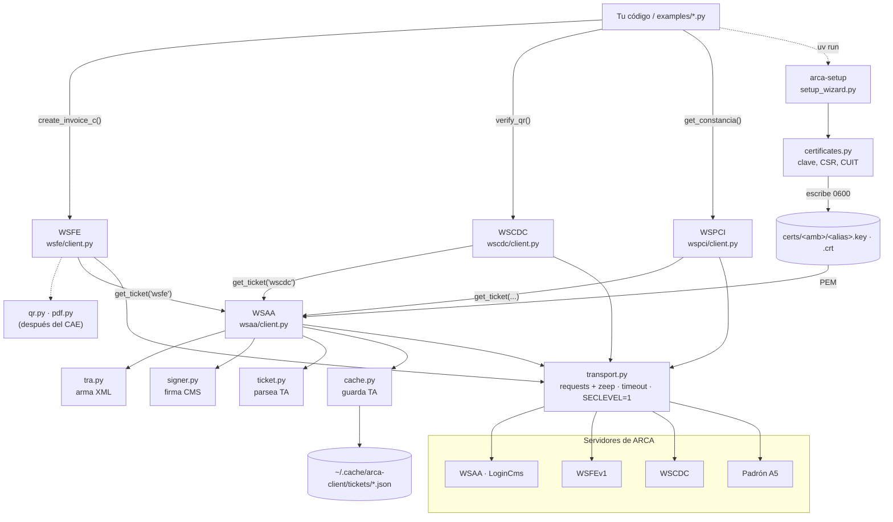
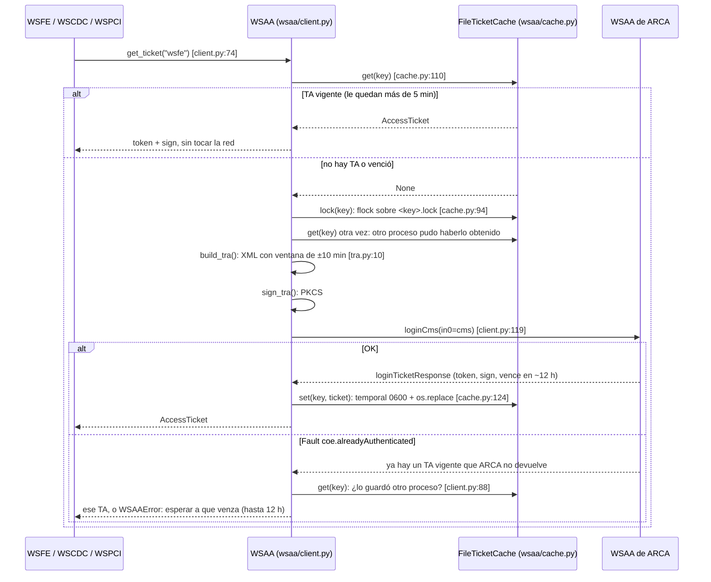
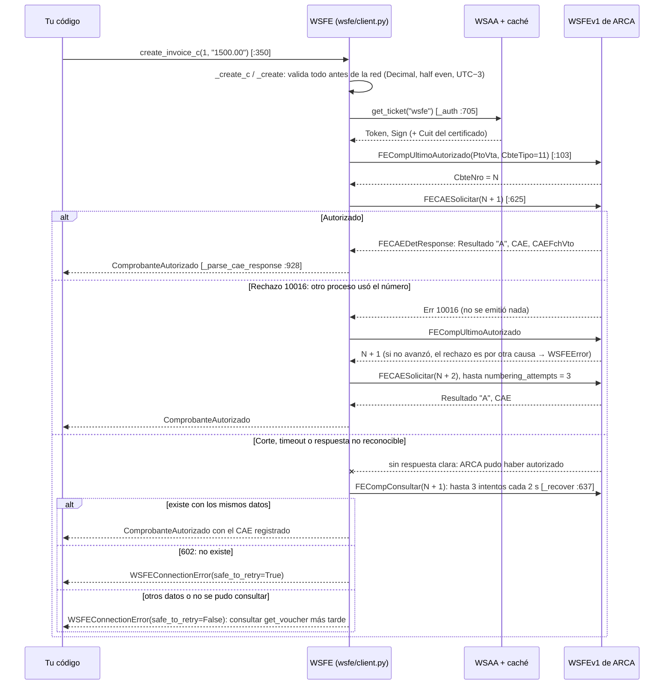
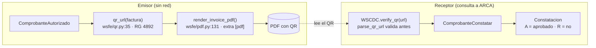
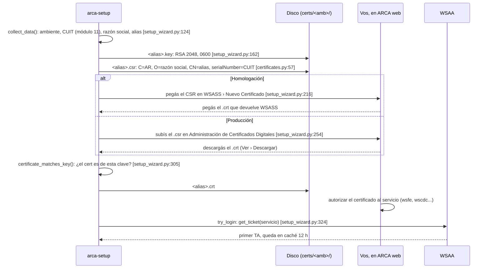

# Arquitectura de arca-client

Cómo se autentica el paquete contra ARCA, cómo pide un CAE y qué hace cuando algo sale mal.
Hay una versión interactiva con más detalle por paso en [`arquitectura.html`](arquitectura.html)
(descargala y abrila en el navegador). Las referencias `archivo:línea` son relativas a
`src/arca_client/` y corresponden al commit `7a49d55`: con el tiempo pueden correrse.

```python
wsaa = WSAA.from_alias("miapp", Environment.HOMOLOGACION)  # lee certs/homologacion/miapp.*
wsfe = WSFE(wsaa)                                         # la CUIT sale del certificado
factura = wsfe.create_invoice_c(punto_venta=1, importe_total="1500.00")  # TA + CAE
factura.numero, factura.cae                               # → QR / PDF
```

Crear los objetos no toca la red. La primera llamada a ARCA ocurre dentro de `create_invoice_c`,
que pide el ticket si hace falta.

## Vocabulario

| Término | Qué es |
|---|---|
| WSAA | Web service de autenticación. Recibe tu firma y devuelve un ticket. |
| TRA | Ticket de Requerimiento de Acceso: el XML que se firma para pedir el ticket. |
| CMS | El TRA firmado con la clave privada (PKCS#7, en Base64). |
| TA | Ticket de Acceso: `token` + `sign`. Vale 12 h y no se puede pedir otro mientras haya uno vigente. |
| WSFEv1 | Web service de factura electrónica. Autoriza comprobantes. |
| CAE | Código de Autorización Electrónico: lo que hace válida a la factura. |
| CbteTipo 11 | Factura C. El número es correlativo por punto de venta y tipo. |
| Homologación | Ambiente de prueba. Emite de verdad (consume numeración), pero sin validez fiscal. |

## Mapa de módulos



`SECLEVEL=1` se aplica a todo homologación y, en producción, solo a `servicios1.afip.gov.ar`
(WSFEv1 y WSCDC), que usa una clave DH chica que OpenSSL 3 rechaza.

## Autenticación (WSAA)

Cada operación de WSFE, WSCDC y WSPCI llama a `get_ticket(servicio)`. La clave del caché combina
ambiente, servicio y huella del certificado (`_cache_key`, `wsaa/client.py:128`).



Por el caso `coe.alreadyAuthenticated`, no hay que borrar `~/.cache/arca-client/tickets/` ni usar
`force=True`. Desde la caché se exige que la carpeta sea privada (0700 y del usuario actual).

## Emisión de una Factura C (WSFEv1)

El número no lo elegís vos: se calcula como el último autorizado + 1 (`_emitir`,
`wsfe/client.py:608`). Por eso el riesgo principal no es un rechazo sino un corte justo después de
enviar, cuando no se sabe si ARCA llegó a autorizar.



**Nunca reintentar `create_invoice_c` a ciegas.** Vuelve a calcular el número y, si el primer
intento sí se autorizó, se emiten dos facturas. Los nombres de los campos salen del WSDL
(`tests/fixtures/wsfev1.wsdl`), no del manual.

## Después del CAE: QR, PDF y verificación



El QR codifica `https://www.arca.gob.ar/fe/qr/?p=` seguido de un JSON en Base64 con CUIT, punto
de venta, tipo, número, importe y CAE. El PDF valida que los ítems sumen lo que ARCA autorizó.

## Certificado y clave (`arca-setup`)

Se hace una vez por ambiente. La clave privada se genera localmente y nunca sale de la máquina: a
ARCA solo viaja el CSR, que es público.



Después, `WSAA.from_alias("miapp", env)` encuentra `certs/#lt;amb#gt;/miapp.crt` y `.key`
(`certificate_paths`, `certificates.py:95`). La CUIT que usa WSFE sale del `serialNumber` del
certificado (`cuit_from_certificate`, `certificates.py:109`).

## Errores

Todos heredan de `ArcaError` (`exceptions.py`). La pregunta importante es siempre: ¿se emitió algo?

| Excepción | Cuándo | ¿Se emitió? | Qué hacer |
|---|---|---|---|
| `WSAAError` | El WSAA rechazó el login (`.code`, ej. `coe.alreadyAuthenticated`, `cms.cert.expired`). | Nada | Si `.retryable` (`wsaa.*`, `wsn.unavailable`), reintentar después de 60 s. Si es `alreadyAuthenticated` sin TA en caché, esperar a que venza. |
| `WSFEError` | Rechazo explícito de ARCA (`.codes`, errores, observaciones). | No | Corregir los datos. Un rechazo no consume número. |
| `WSFEConnectionError` | Corte al pedir el CAE. | Ver `safe_to_retry` | `True`: se puede reintentar. `False`: no reintentar, consultar `get_voucher(pv, tipo, err.numero)`. |
| `RespuestaNoReconocida` | Respuesta que no se pudo interpretar. Dentro de `create_*` dispara la verificación. | Quizás | Nunca tratarla como rechazo. La respuesta completa está en `.respuesta`. |
| `WSCDCError` | Error de la constatación. | — | Solo consulta: es seguro reintentar. |
| `WSPCIError` · `PersonaNoEncontrada` | Error del padrón o CUIT inexistente. | — | Solo consulta. Una CUIT inactiva no lanza error: viene en `errores_constancia`. |
